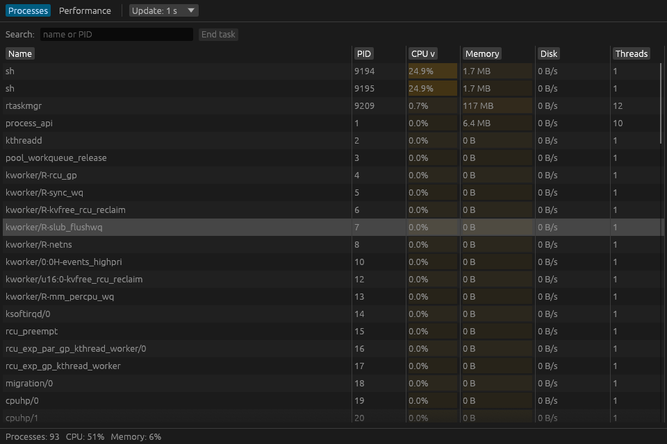
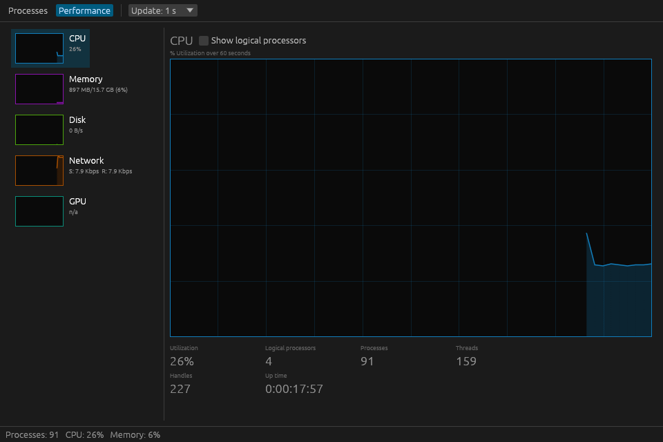
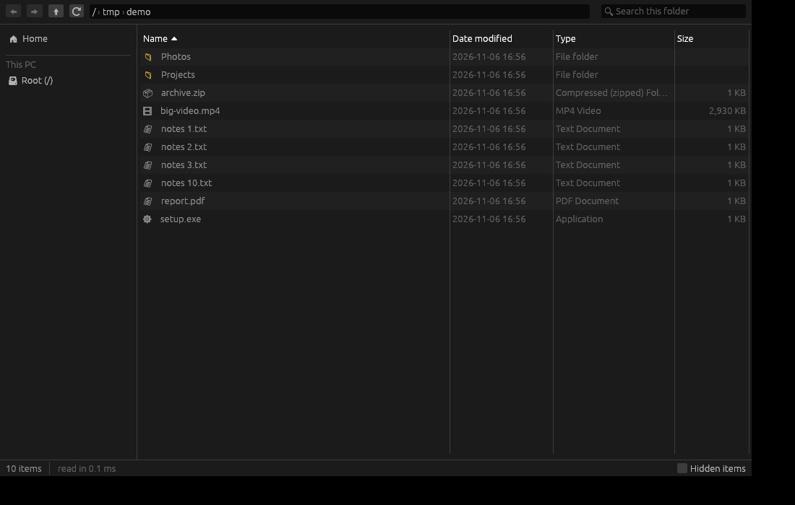

# oxidows

Default Windows apps rewritten in Rust, aiming to start faster and use less memory than the originals.
Clean-room: behaviour is matched by observation; no Microsoft code, icons or resources are used.
The apps draw text and in-app icons with the fonts Windows already has (Segoe UI, Segoe Fluent Icons),
read from `%WINDIR%\Fonts` at run time and never bundled; the app icons are our own
([`scripts/make-icons.py`](scripts/make-icons.py)).

| App | Status (v0.4.0) | Path |
| --- | --- | --- |
| Task Manager | All pages of the Windows 11 one: Processes, Performance (CPU, memory, every disk, network adapter, GPU and NPU, with GPU and disk temperatures), App history, Startup apps, Users, Details, Services, Settings. 80 of 80 [parity](docs/parity/taskmgr.md) rows done | [`apps/taskmgr`](apps/taskmgr) |
| File Explorer | Tabs, every view (icons, list, details, tiles, content) with thumbnails, the shell's right-click menu, Windows Search, Recycle Bin, network shares (SMB), phones over MTP, nearby sharing with phones through LocalSend. 84 of 84 [parity](docs/parity/explorer.md) rows done | [`apps/explorer`](apps/explorer) |

## Download

1. Download `oxi-taskmgr.exe` and/or `oxi-explorer.exe` from the
   [latest release](https://github.com/vuuminhphuoc/oxidows/releases/latest)
   (Windows 10/11 x64). There is no installer: each exe is the whole app.
2. Double-click it. The exe is not code-signed yet, so on first run SmartScreen may show
   "Windows protected your PC": click **More info**, then **Run anyway**.
3. Settings are kept in `%APPDATA%\oxidows` (`taskmgr.ini`, `explorer.ini`). Delete the exe and
   that folder to remove everything.

Task Manager shows and ends elevated processes, the Network column and App history only when run
as administrator (its *Run as administrator* button relaunches it through UAC).
Nearby sharing in Explorer needs the free [LocalSend](https://localsend.org) app on the phone; see
[`apps/explorer`](apps/explorer#nearby-sharing-localsend).

## Use them as the default apps

Each app can take over the Windows shortcuts that open its original, and give them back:

| App | Where | Takes over | Needs |
| --- | --- | --- | --- |
| Task Manager | Settings > Default app > Set as default | Ctrl+Shift+Esc, Ctrl+Alt+Del > Task Manager, taskbar right-click > Task Manager, anything that runs `taskmgr.exe` | administrator (Windows asks) |
| File Explorer | `…` > Options > Set as default | Win+E, opening a folder or drive from the desktop, Start, Run or another app | nothing, your account only |

Explorer never replaces the shell: the taskbar, Start and the desktop stay File Explorer's.
**Restore** in the same place puts back exactly what was there before (Windows' own app, or a tool
such as Process Explorer or Files that had it), and removes every registry entry the app made.
Move or delete the exe only after restoring. To undo without opening the app, run
`oxi-taskmgr.exe --restore-default` or `oxi-explorer.exe --restore-default` (`--set-default` does
the opposite; add `--quiet` to skip the message box).

| Processes | Performance |
| --- | --- |
|  |  |



<sub>Screenshots from the Linux development build, with the Segoe fonts of a Windows 11 PC.</sub>

## One look for every app

All apps share [`crates/ui-common`](crates/ui-common): a Windows 11 theme (Mica-grey chrome, the
user's accent color, 4 px corners, Segoe UI), light/dark following the system or the app's setting,
one icon set (`ui_common::Icon`), the same navigation rows, toolbar buttons and page titles, and app
icons drawn as one family. A new app calls `ui_common::setup(ctx, theme)` once and uses those widgets.

## Speed and memory

Measured on a Windows 11 PC (Core i5-13500, RTX 3060), details and every release in
[docs/benchmarks.md](docs/benchmarks.md):

| | Window shown after | Memory (private working set) | Idle CPU |
| --- | --- | --- | --- |
| Windows Task Manager | n/a (elevated) | 120 MB | 0.58 % |
| oxi-taskmgr | 48 ms | 53 MB | 0.05 % |
| Windows File Explorer (own process) | 765 ms | 67 MB | 0.00 % |
| oxi-explorer | 47 ms | 40 MB | 0.00 % |

The apps draw with OpenGL on PCs with an NVIDIA, AMD or Intel GPU driver, and with wgpu
(WARP software rendering) on VMs, RDP and CI runners. `OXI_RENDERER=glow|wgpu` picks one.

## Layout

- `apps/<name>`: one executable per rewritten app (`oxi-<name>.exe`).
- `crates/<app>-core`: logic with no OS calls, unit-tested (`taskmgr-core`, `explorer-core`).
- `crates/<app>-sys`: everything that talks to Windows; all `unsafe` lives here (`taskmgr-sys`, `explorer-sys`).
- `crates/oxi-share`: the LocalSend v2 protocol (discovery, send, receive) used by Explorer's nearby sharing.
- `crates/ui-common`: the shared look (theme, fonts, icons, widgets, app icons) and renderer choice.
  Code shared by several apps goes in an unprefixed crate when a second app needs it.
- `docs/parity/<app>.md`: every feature of the Windows app and where the rewrite stands.

## Build

```sh
cargo test --workspace
cargo build --release -p oxi-taskmgr
cargo build --release -p oxi-explorer
```

The toolchain is pinned in `rust-toolchain.toml`. CI (`.github/workflows/ci.yml`) runs clippy, tests and a
release build on `windows-latest`, then [`scripts/smoke-all.ps1`](scripts/smoke-all.ps1) launches every
`oxi-*.exe` and records time to window, private working set, idle CPU and a screenshot (job summary +
`smoke-results` artifact), plus one screenshot per view listed in `apps/<name>/smoke.json`. Name a new
app's binary `oxi-<app>` and it is smoke-tested and released automatically.

To release, bump `version` in the root `Cargo.toml`. The first green CI run of that version on `main`
publishes every exe as GitHub Release `v<version>` (pushing a `v*` tag does the same).

## License

Dual-licensed under [MIT](LICENSE-MIT) or [Apache-2.0](LICENSE-APACHE), at your option.
