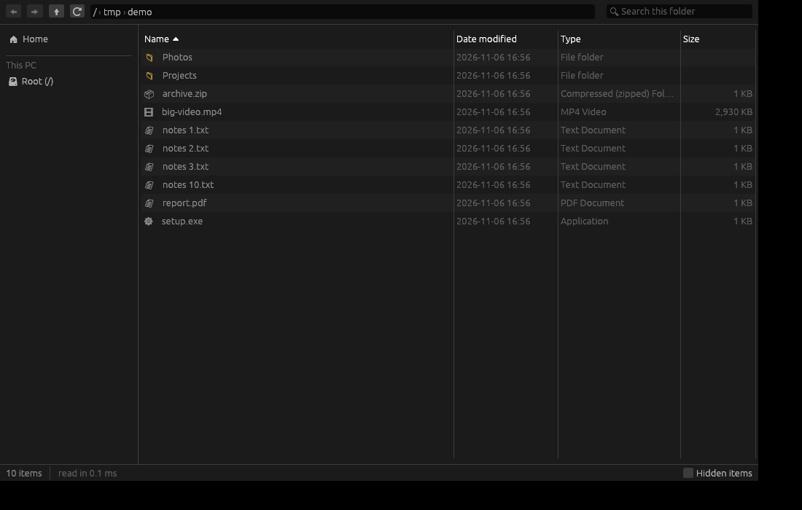

# File Explorer (oxi-explorer)

A fast Windows File Explorer written in Rust, with every feature of the Windows 11 one
([parity checklist](../../docs/parity/explorer.md): 84 of 84 rows done in v0.4.0).



## What works

- **Navigation**: Back / Forward / Up, breadcrumbs with a subfolder dropdown per segment, typed paths
  with autocomplete (`%TEMP%`, `shell:startup`, UNC), recent locations, tabs (drag to reorder or out
  into a new window), Ctrl+N new window, folder tree, Quick access pins, This PC.
- **Views**: Extra large / Large / Medium / Small icons, List, Details, Tiles, Content
  (Ctrl+Shift+1…8), Compact view; system icons with overlays, thumbnails from the shell's cache;
  choose and resize columns (Date created, Attributes, Authors, Dimensions, Owner, …), group by,
  preview pane (the registered Windows preview handlers: Office, PDF, media) and details pane.
- **Files**: the shell's own right-click menu (7-Zip, Git, Send to, Open with, New ▸, …),
  Cut / Copy / Paste through the real Windows clipboard, Copy as path, Rename and batch rename,
  Recycle Bin or permanent delete with the native progress and conflict dialogs, Undo / Redo,
  drag and drop in, between and out of the window, Properties, Open in Terminal.
- **Search**: filter as you type, Enter searches subfolders through the Windows Search index
  (file contents, `kind:`, `date:`), with its own walk where the index is missing.
- **Places**: Recycle Bin (restore, empty), Home with recent files, Libraries, Gallery, OneDrive
  status, Control Panel and other shell folders, network shares (`\\server` lists its shares,
  Windows' sign-in dialog, map / disconnect drives), computers and media devices on the LAN, and
  phones over MTP under This PC (browse, thumbnails, copy both ways).
- **Behaviour**: folders refresh by themselves, large folders stay responsive, long paths work,
  window size and per-folder view and sort are remembered, light / dark theme follows Windows.

## Nearby sharing (LocalSend)

The **Share** button and **Nearby sharing** in the sidebar send and receive files with phones and
computers running the free [LocalSend](https://localsend.org) app (Android, iPhone, Mac, Linux,
Windows; no account, no internet, no Google services needed). `crates/oxi-share` implements the
open [LocalSend v2 protocol](https://github.com/localsend/protocol): multicast discovery on every
network interface (with a subnet scan for networks that drop multicast), a HTTPS server with
self-signed certificates identified by fingerprint, and the sending side. Sharing is off until
turned on in the window.

- On the same Wi-Fi: open LocalSend on the phone; this PC shows up under *Send*, and the phone
  shows up in Explorer's window. Received files go to Downloads (changeable).
- No common Wi-Fi: *Connect with Wi-Fi Direct* makes the PC open its own Wi-Fi Direct network and
  shows a QR code. The phone's camera joins it, then LocalSend works over it. Needs a Wi-Fi adapter
  with Wi-Fi Direct (most made after 2015); *Allow* adds the firewall rule that network needs.

## Layout

| Path | What it does |
| --- | --- |
| `crates/explorer-sys` | Talks to Windows. A folder is read with one `FindFirstFileExW(FindExInfoBasic, FIND_FIRST_EX_LARGE_FETCH)` pass: no per-file stat, no 8.3 names, results stream in batches of 2048. The shell does the rest: `SHFileOperationW` / `IFileOperation` for copy, move and delete, `IContextMenu3` menus, `IShellItem` for phones, Control Panel and network devices, `IShellItemImageFactory` thumbnails, preview handlers, search folders, `NetShareEnum` and `WNetAddConnection2W` for SMB, Wi-Fi Direct and firewall rules for sharing. All `unsafe` lives here; a `std::fs` fallback exists for Linux development only. Integration tests in `tests/windows.rs` run on CI (including a real SMB share on localhost). |
| `crates/explorer-core` | No OS calls: sorting, natural order, filtering, the search query language, size/date/type text, name validation, back/forward history. Unit-tested. |
| `crates/oxi-share` | The LocalSend v2 protocol on plain threads (no async runtime). |
| `apps/explorer` | egui app. Listing, watching, thumbnails and file operations each run on their own thread, so the window never waits on the disk. Views are virtualised (only visible rows are laid out) and the sorted view is cached until the listing, sort or search changes. |

## Build

```sh
cargo build --release -p oxi-explorer                                  # on Windows
cargo build --release -p oxi-explorer --target x86_64-pc-windows-gnu   # cross from Linux (needs mingw-w64)
```

`oxi-explorer.exe <folder>` opens that folder. `OXI_EXPLORER_TIMING=1` prints how long the first listing took,
`OXI_EXPLORER_NEARBY=1` opens the Nearby sharing window at start.
`cargo run -p oxi-share --example peer -- "Name" [files]` runs a stand-in LocalSend device for testing.
